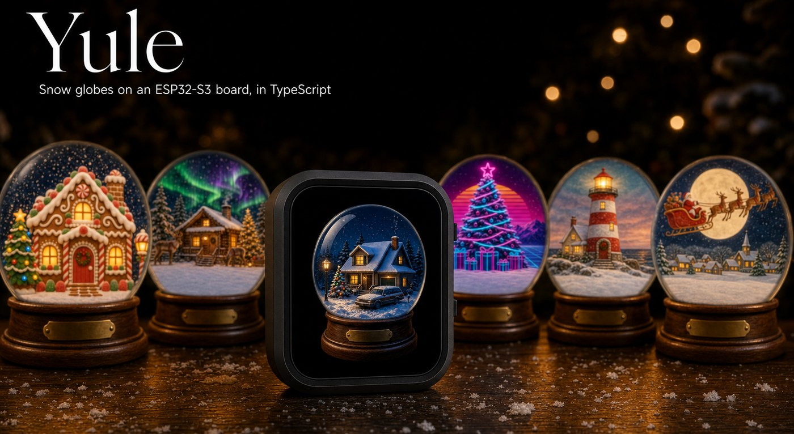

# Yule

Twenty-seven Christmas snow globes on an ESP32-S3 board: the Waveshare Touch
AMOLED 2.06 (410x502 screen, accelerometer and gyro). Hold the board like a
globe. Shake it and the snow fills the water, tilt it left or right and
the falling snow drifts that way. Lights flicker, smoke rises, trees sway in
the wind, stars shoot, and a playlist of Christmas songs plays. It is
written in TypeScript with GeaStack.

https://github.com/user-attachments/assets/0cc5c18a-e633-4939-96bd-07bc670aff09

| | | | |
| :---: | :---: | :---: | :---: |
| 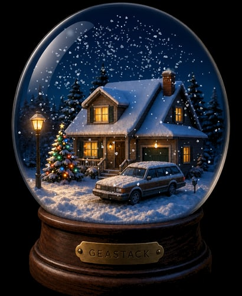<br>Yule | <br>Gingerbread | <br>Nordic Night | 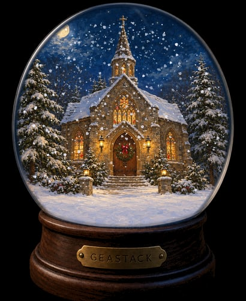<br>Silent Chapel |
| <br>Aurora | 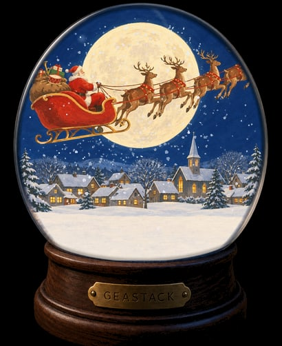<br>Santa's Sleigh | <br>Snow Family | 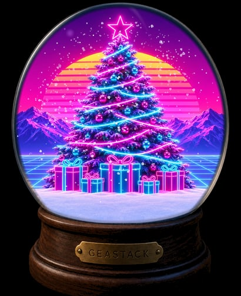<br>Neon Noel |
| 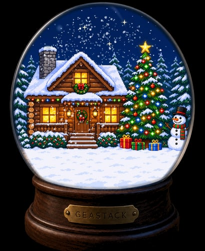<br>Pixel Pines | 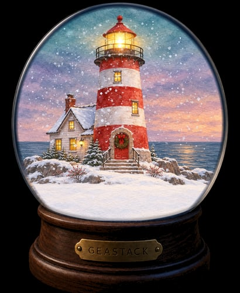<br>Harbour Light | 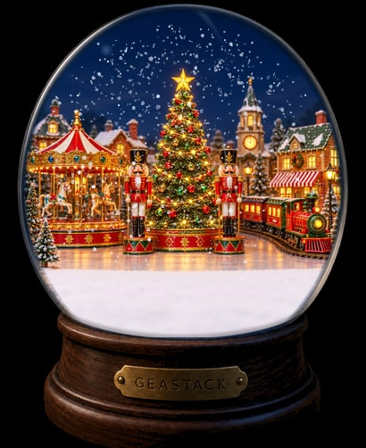<br>Toy Town | <br>Tree Farm |
| <br>Castle | 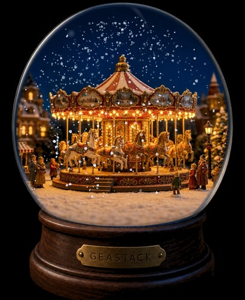<br>Carousel | <br>Polar Cub | 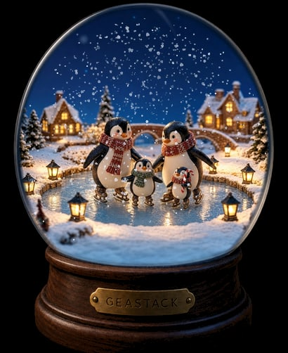<br>Penguins |
| <br>Rocking Santa | <br>Cardinals | 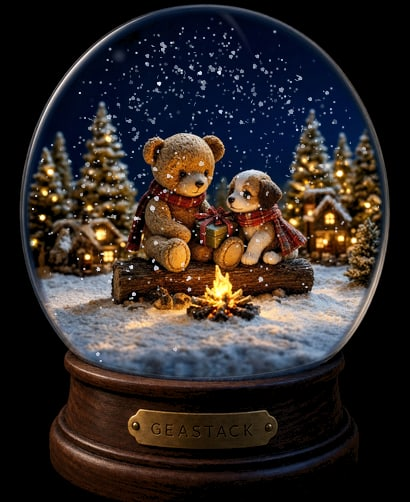<br>Bear & Puppy | 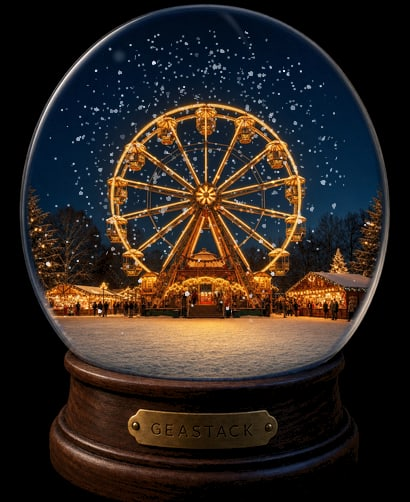<br>Ferris Wheel |
| 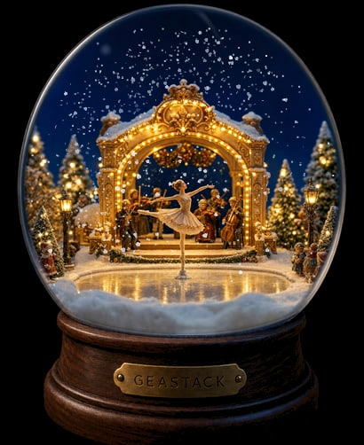<br>Ice Ballet | 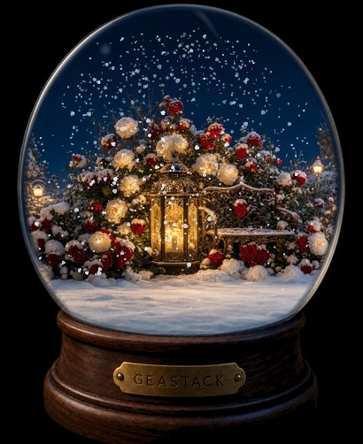<br>Winter Roses | 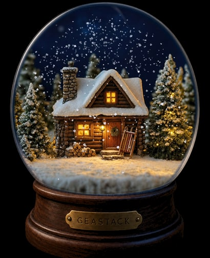<br>Log Cabin | 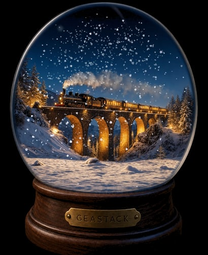<br>Night Train |
| 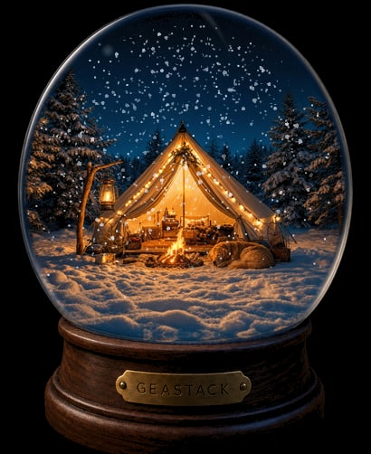<br>Campfire | <br>Woodland | <br>Ice Fishing |  |

## Tutorial

### 1. Flash it

You need Node 22+ and ESP-IDF 6.0.2, installed in `~/esp32/esp-idf-v6.0.2`
(or with `IDF_PATH` set to it). Install the packages, register the board
on USB as `amoled` (the setup asks for the name), then flash:

```sh
npm ci
npx --no-install gea setup
npm run flash
```

Yule is the one globe built in. The first start shows Neon Noel if it is
already on the card (step 2), and Yule if it is not. To start on another
globe, set `DEFAULT_GLOBE` in `src/lib/globes.ts` (0 is Yule, 7 Neon Noel,
26 Ice Fishing, in the order above).

### 2. Fill the microSD card

The other 26 globes and the songs live on the card:

```sh
node scripts/bake.mjs                          # globes
node scripts/music.mjs <folder of .raw songs>  # songs
sh scripts/push.sh                             # onto the card over USB
```

Push with the menu open and music off. Without a card, Yule and the built-in
music box still work.

### 3. Use it

- **Shake** the board: the harder you shake, the more snow lifts, up to a
  globe full of it. When you stop, the water swirls on and the snow
  tumbles down in its own time.
- **Tilt** it left or right: the falling snow drifts slowly to the low
  side. A slow turn never counts as a shake.
- **Swipe** sideways across the globe for the next or previous globe.
  **Drag** slowly to push the snow with your finger; **tap** the glass to
  make the settled snow hop.
- **Tap the wooden base** (or press the USER button) for the menu: pick a
  globe, a song (the music box, wound by shaking, or eleven Christmas
  songs), or the settings (music, volume, wind, a new globe every 5
  minutes). The USER button steps back; your choices are kept.

### 4. Preview it in a browser

```sh
npm run dev
```

The preview reads the globes from `.gea/sd/yule` after a bake. It lies
face-up with no music. To tilt it, set `__gea_Accelerometer.feel` in the
console (m/s² along the board's x, y and z; y runs across the screen), e.g.
`__gea_Accelerometer.feel = [0, 4, -9]`.

### 5. Run it on a Mac

Yule also builds as a Mac app (needs Xcode). The app takes the globes
and songs from `.gea/sd`, so bake them (step 2) before building:

```sh
npx --no-install gea run --target macos
```

It opens `dist/macos/yule/Yule.app`. A Mac has no accelerometer, so there
the globe stands still: stir and swipe it with the mouse.

## How it works

[docs/HOW-IT-WORKS.md](docs/HOW-IT-WORKS.md) covers the water, the snow, the
tracing of each globe, the card and memory.

Music credits: [music/CREDITS.md](music/CREDITS.md). Three songs are by Kevin
MacLeod under CC BY 3.0, which requires credit wherever this is shown; the
rest are US Air Force band recordings in the public domain.

## License

Copyright 2026 Geastack contributors. GPL-3.0-only; see [LICENSE](LICENSE).
Third-party dependencies, fonts and assets retain their respective licenses
and attribution notices; the Hanken Grotesk fonts are under the SIL Open Font
License ([src/fonts/OFL.txt](src/fonts/OFL.txt)).
