# Yule

Twenty-seven Christmas snow globes on an ESP32-S3 board: the Waveshare Touch
AMOLED 2.06 (410x502 screen, accelerometer and gyro). Hold the board like a
globe: shake it and the snow fills the water, tilt it and the snow drifts
to the low side, turn it over and it falls to the top of the glass. Lights
flicker, smoke rises, trees sway in the wind, stars shoot, and a playlist of
carols plays. It is all TypeScript, compiled ahead of time to native code:
no native code of its own, and no browser or JavaScript engine on the
device.

| | | | |
| :---: | :---: | :---: | :---: |
| <br>Yule | 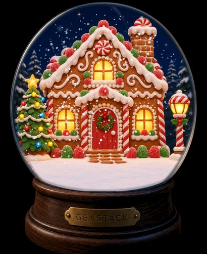<br>Gingerbread | 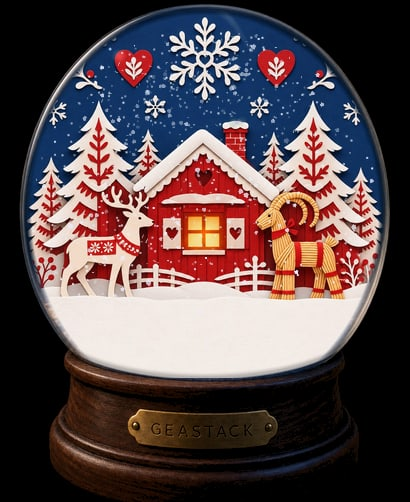<br>Nordic Night | <br>Silent Chapel |
| 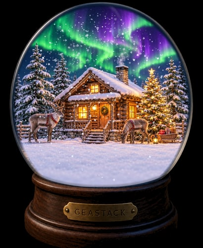<br>Aurora | <br>Santa's Sleigh | 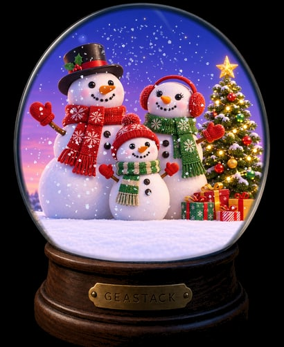<br>Snow Family | <br>Neon Noel |
| <br>Pixel Pines | <br>Harbour Light | <br>Toy Town | 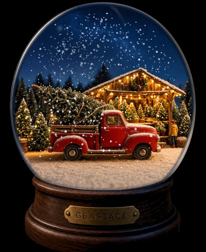<br>Tree Farm |
| 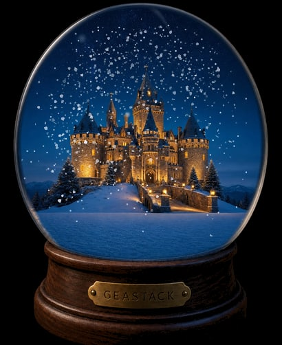<br>Castle | <br>Carousel | 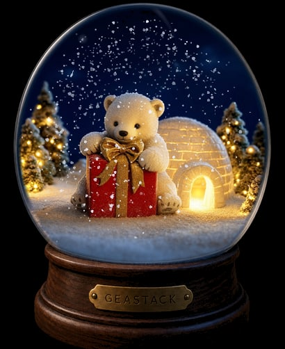<br>Polar Cub | <br>Penguins |
| 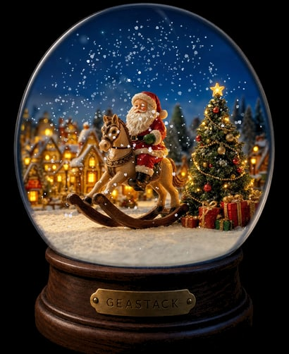<br>Rocking Santa | 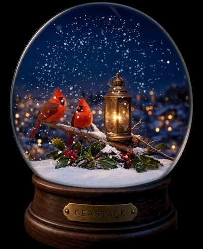<br>Cardinals | <br>Bear & Puppy | <br>Ferris Wheel |
| <br>Ice Ballet | <br>Winter Roses | <br>Log Cabin | <br>Night Train |
| <br>Campfire | 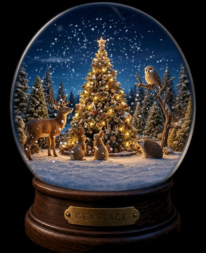<br>Woodland | 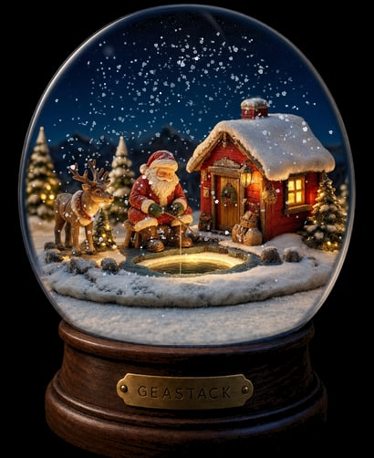<br>Ice Fishing |  |

## Tutorial

### 1. Flash it

You need Node 22+ and ESP-IDF 6.0 (`IDF_PATH` set to it). With the board on
USB and registered as `amoled` (`npx --no-install gea setup`):

```sh
npm ci
npm run flash
```

Yule is built in. To flash with another globe showing, set `DEFAULT_GLOBE`
in `src/lib/globes.ts` (0 is Yule, 26 Ice Fishing, in the order above).

### 2. Fill the microSD card

The other 26 globes and the songs live on the card:

```sh
node scripts/bake.mjs                          # globes
node scripts/music.mjs <folder of .raw songs>  # songs
sh scripts/push.sh                             # onto the card over USB
```

Push with the menu open and music off. Without a card, Yule and the built-in
music box still work.

### 3. Use it

- **Shake** the board: the harder you shake, the more snow lifts, up to a
  globe full of it. When you stop, the water swirls on and the snow
  tumbles down in its own time (15-30 s).
- **Tilt** it: the snow drifts slowly to the low side and heaps against the
  glass; turn it upside down and it falls to the top. Lying flat, it
  settles against the back. A slow turn never counts as a shake.
- **Swipe** sideways across the globe for the next or previous globe.
  **Drag** slowly to stir the water with your finger; **tap** for a little
  whirlpool.
- **Tap the wooden base** (or press the USER button) for the menu: pick a
  globe, a song (the music box, wound by shaking, or eleven carols), or the
  settings (music, volume, wind, a new globe every 5 minutes). The USER
  button steps back; your choices are kept.

### 4. Preview it in a browser

```sh
npm run dev
```

The preview reads the globes from `.gea/sd/yule` after a bake. It lies
face-up with no music; tilt it from the console, e.g.
`__gea_Accelerometer.feel = [9.8, 0, 0]` to stand it upright.

## Numbers

- 24-27 fps with the snow settled, 15 in a gust, about 11 right after a hard
  shake or a switch, back to 20 within 15-20 s.
- A globe switch takes about 0.4 s; a song plays on through it.
- The firmware is 3.2 MB. Each globe is 282 KB on the card (7.3 MB for 26),
  and the songs are 47 MB.

How it all works (the water, the snow, the tracing of each globe, the card,
memory): [docs/HOW-IT-WORKS.md](docs/HOW-IT-WORKS.md).

Music credits: [music/CREDITS.md](music/CREDITS.md). Three songs are by Kevin
MacLeod under CC BY 3.0, which requires credit wherever this is shown; the
rest are US Air Force band recordings in the public domain.

## License

Copyright 2026 Geastack contributors. GPL-3.0-only; see [LICENSE](LICENSE).
Third-party dependencies, fonts and assets retain their respective licenses
and attribution notices; the Hanken Grotesk fonts are under the SIL Open Font
License ([src/fonts/OFL.txt](src/fonts/OFL.txt)).
